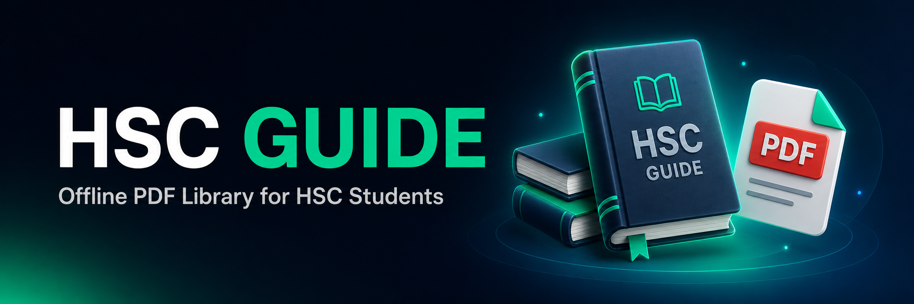

<div align="center">



# 📚 HSC Guide

**HSC শিক্ষার্থীদের জন্য অফলাইন PDF লাইব্রেরি অ্যাপ**

[](https://github.com/HasibApps/apk-05/actions/workflows/build.yml)
[](https://github.com/HasibApps/apk-05/releases/latest)
[](https://github.com/HasibApps/apk-05/releases)
[](https://github.com/HasibApps/apk-05/releases/latest)
[-3DDC84?logo=android&logoColor=white)](https://developer.android.com)
[](https://kotlinlang.org)

### [⬇️ APK ডাউনলোড করুন](https://github.com/HasibApps/apk-05/releases/latest/download/HscGuide-release.apk)

</div>

---

## 📲 ডাউনলোড

| ধরন | ডাউনলোড লিংক | সাইজ | বিবরণ |
| :-- | :-- | :-- | :-- |
| 🟢 **Release (সাইন করা)** | **[HscGuide-release.apk](https://github.com/HasibApps/apk-05/releases/latest/download/HscGuide-release.apk)** | ~2.6 MB | সাধারণ ব্যবহারের জন্য — **এটাই ইনস্টল করুন** |
| 🟡 **Debug** | [HscGuide-debug.apk](https://github.com/HasibApps/apk-05/releases/latest/download/HscGuide-debug.apk) | ~3.3 MB | টেস্টিং / ডেভেলপারদের জন্য |
| 📄 **সব ভার্সন** | [Releases পেজ](https://github.com/HasibApps/apk-05/releases) | — | পুরোনো ও নতুন সব ভার্সন |

> নির্দিষ্ট ভার্সনের লিংক: `https://github.com/HasibApps/apk-05/releases/download/v1.0.0/HscGuide-v1.0.0-release.apk`

## 🔗 গুরুত্বপূর্ণ লিংক

| | লিংক |
| :-- | :-- |
| 📦 GitHub Repository | https://github.com/HasibApps/apk-05 |
| 🚀 Latest Release | https://github.com/HasibApps/apk-05/releases/latest |
| 🏷️ Release v1.0.0 | https://github.com/HasibApps/apk-05/releases/tag/v1.0.0 |
| ⚙️ GitHub Actions Workflow | https://github.com/HasibApps/apk-05/actions/workflows/build.yml |
| 📥 Build Artifacts (Actions) | https://github.com/HasibApps/apk-05/actions |

## 📥 ইনস্টল করার নিয়ম

1. উপরের **Release APK** লিংক থেকে ফাইলটি ডাউনলোড করুন।
2. ফাইলটিতে ট্যাপ করুন। "Install unknown apps / অজানা উৎস" অনুমতি চাইলে আপনার ব্রাউজারকে **Allow** দিন।
   *Settings → Apps → Special access → Install unknown apps*
3. **Install** চাপুন, তারপর **Open**।
4. প্রথমবার খুললে অ্যাপ নিজে থেকেই ডিফল্ট ডাটা তৈরি করে নেবে।

> ⚠️ পুরোনো কোনো বিল্ড ইনস্টল করা থাকলে আনইনস্টল করে নিন (সিগনেচার আলাদা)।

---

## ✨ ফিচার

| ফিচার | বিবরণ |
| :-- | :-- |
| 📚 **৭টি বিষয়** | বাংলা, ইংরেজি, আইসিটি, পদার্থবিজ্ঞান, রসায়ন, জীববিজ্ঞান, উচ্চতর গণিত |
| 📗 **১ম ও ২য় পত্র** | প্রতিটি বিষয়ে আলাদা পত্র অনুযায়ী সাজানো কনটেন্ট |
| 🗂️ **মূল বই + টেস্ট পেপার** | দুইটি আলাদা সেকশন, ফোল্ডার সাপোর্ট (নেস্টেড) |
| ☁️ **Google Drive সাপোর্ট** | Drive শেয়ার লিংক অটো-কনভার্ট করে সরাসরি ডাউনলোড |
| 📴 **সম্পূর্ণ অফলাইন** | একবার ডাউনলোড হলে ইন্টারনেট ছাড়াই পড়া যায় |
| 🖼️ **অটো থাম্বনেইল** | PDF-এর প্রথম পৃষ্ঠা থেকে থাম্বনেইল তৈরি হয় |
| 🔍 **বিল্ট-ইন PDF রিডার** | পিঞ্চ-জুম (1x–4x), নির্দিষ্ট পেজে যাওয়া, স্ক্রল ভিউ |
| 🔐 **অ্যাডমিন মোড** | পাসওয়ার্ড দিয়ে আনলক — ফোল্ডার/PDF যোগ, এডিট, ডিলিট |
| 💾 **JSON ব্যাকআপ** | পুরো কনটেন্ট `.json` হিসেবে এক্সপোর্ট ও ইমপোর্ট |
| 🌙 **ডার্ক থিম** | চোখের আরামদায়ক ডার্ক UI, বাংলা টাইপোগ্রাফি |

## 🧩 অ্যাপ সম্পর্কে

**HSC Guide** হলো HSC (উচ্চ মাধ্যমিক) শিক্ষার্থীদের জন্য একটি হালকা ও দ্রুত অফলাইন PDF লাইব্রেরি।
বিষয়ভিত্তিক মূল বই ও টেস্ট পেপার Google Drive লিংক থেকে ডাউনলোড করে ফোনে সংরক্ষণ করা যায়,
তারপর অ্যাপের ভেতরের রিডার দিয়েই পড়া যায় — কোনো তৃতীয় পক্ষের PDF অ্যাপ বা ইন্টারনেট লাগে না।

অ্যাডমিন মোডের মাধ্যমে নিজের লাইব্রেরি নিজেই গুছিয়ে নিতে পারবেন, আর `.json` ফাইলের মাধ্যমে
এক ফোনের কনটেন্ট অন্য ফোনে বা বন্ধুদের সাথে শেয়ার করা যায়।

## 🛠️ টেক স্ট্যাক

| | |
| :-- | :-- |
| **Language** | Kotlin 1.9.24 |
| **Build System** | Gradle 8.7 · Android Gradle Plugin 8.5.2 |
| **UI** | AndroidX AppCompat, RecyclerView, Material-friendly dark theme |
| **PDF** | Android `PdfRenderer` (built-in, কোনো ভারী লাইব্রেরি নেই) |
| **Storage** | Internal app storage + `org.json` |
| **CI/CD** | GitHub Actions → signed APK → automatic GitHub Release |

## 📋 অ্যাপ ইনফো

| Field | Value |
| :-- | :-- |
| **App Name** | HSC গাইড (HSC Guide) |
| **Package** | `com.hasib.guide` |
| **Version** | 1.0.0 (versionCode 1) |
| **Min SDK** | 26 — Android 8.0 Oreo |
| **Target / Compile SDK** | 34 — Android 14 |
| **Release APK Size** | ~2.6 MB |
| **Signing** | Signed release build (v1 + v2 scheme) |
| **Permissions** | `INTERNET` (PDF ডাউনলোডের জন্য) |
| **Developer** | Hasib Bro · 01831410991 |

## 🗂️ প্রজেক্ট স্ট্রাকচার

```
apk-05/
├── .github/workflows/build.yml     # CI: build + sign + release
├── app/
│   ├── build.gradle.kts            # app module, versioning, signing
│   └── src/main/
│       ├── AndroidManifest.xml
│       ├── java/com/hasib/guide/
│       │   ├── MainActivity.kt     # হোম, বিষয়, ডাউনলোড, অ্যাডমিন
│       │   ├── PdfActivity.kt      # বিল্ট-ইন PDF রিডার
│       │   └── Store.kt            # JSON ডাটা স্টোর + ডিফল্ট কনটেন্ট
│       └── res/                    # layout, drawable, theme
├── docs/banner.png
├── gradle/wrapper/                 # Gradle wrapper (8.7)
├── signing/hscguide-release.p12    # ডেমো রিলিজ কীস্টোর
└── settings.gradle.kts
```

## ⚙️ GitHub Actions দিয়ে বিল্ড

প্রতিটি `main` ব্রাঞ্চে push হলে (অথবা ম্যানুয়ালি **Run workflow**) অটোমেটিকভাবে:

1. JDK 17 + Gradle 8.7 সেটআপ
2. `assembleDebug` + `assembleRelease` (সাইন করা) বিল্ড
3. APK গুলো **Artifacts** হিসেবে আপলোড (৯০ দিন সংরক্ষিত)
4. `versionName` থেকে ট্যাগ নিয়ে **GitHub Release** তৈরি ও APK আপলোড

**ম্যানুয়ালি চালাতে:** Actions → *Build & Release APK* → **Run workflow**

```yaml
on:
  push:
    branches: [ main ]
  workflow_dispatch:
    inputs:
      publish_release:   # Release বানাবে কি না
```

### লোকালি বিল্ড

```bash
git clone https://github.com/HasibApps/apk-05.git
cd apk-05
./gradlew assembleRelease
# আউটপুট: app/build/outputs/apk/release/app-release.apk
```

> **সাইনিং:** `signing/hscguide-release.p12` হলো একটি পাবলিক ডেমো কীস্টোর (পাসওয়ার্ড: `hscguide2026`)।
> নিজের কী ব্যবহার করতে চাইলে `signing.properties` ফাইলে অথবা
> `SIGNING_STORE_FILE`, `SIGNING_STORE_PASSWORD`, `SIGNING_KEY_ALIAS`, `SIGNING_KEY_PASSWORD`
> এনভায়রনমেন্ট ভ্যারিয়েবল দিয়ে পথ ও পাসওয়ার্ড বদলান।

## 🔐 অ্যাডমিন

অ্যাপের ⚙ আইকন → **👤 Admin** → পাসওয়ার্ড দিন। পাসওয়ার্ড কোডে প্লেইন টেক্সটে নেই,
SHA-256 হ্যাশ হিসেবেই যাচাই হয় (`Store.ADMIN_HASH`)।

## 🖼️ স্ক্রিনশট

> বিল্ড করা APK ইনস্টল করে স্ক্রিনশট এখানে যোগ করা যাবে।

## 🤝 কন্ট্রিবিউট

Issue খুলুন বা Pull Request পাঠান — যেকোনো সাজেশন স্বাগতম।

## 📄 লাইসেন্স

এই প্রজেক্টটি শিক্ষামূলক উদ্দেশ্যে তৈরি। অ্যাপে যুক্ত PDF গুলোর স্বত্ব তাদের নিজ নিজ প্রকাশকের।
ব্যক্তিগত পড়াশোনার বাইরে বাণিজ্যিক ব্যবহার নিষিদ্ধ।

---

<div align="center">

**© 2026 HSC 26 · The App Create By Hasib Bro · 01831410991**

⭐ ভালো লাগলে রিপোতে একটি **Star** দিন!

</div>
