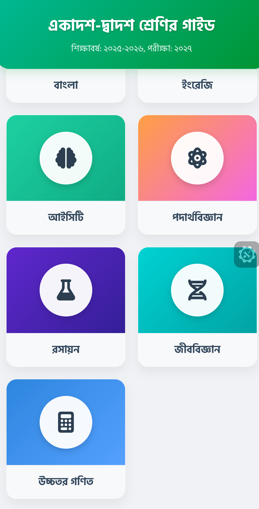
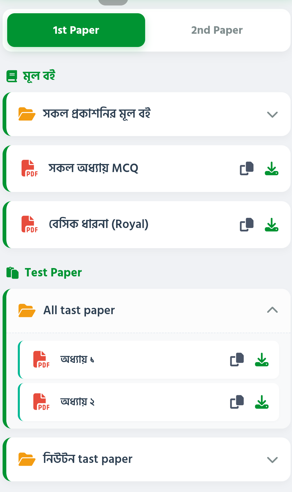
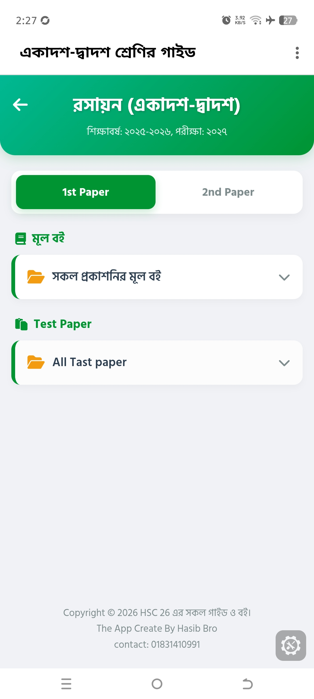

<div align="center">


# 📚 HSC গাইড · v4.0.0

**একাদশ-দ্বাদশ (HSC 26) শিক্ষার্থীদের জন্য সম্পূর্ণ গাইড — মূল বই, টেস্ট পেপার ও অফলাইন PDF রিডার**

[](https://github.com/HasibApps/apk-05/actions/workflows/build.yml)
[](https://github.com/HasibApps/apk-05/releases/latest)
[](https://github.com/HasibApps/apk-05/releases)
[](https://github.com/HasibApps/apk-05/releases/latest)
[-3DDC84?logo=android&logoColor=white)](https://developer.android.com)
[](https://kotlinlang.org)

### [⬇️ APK v4.0.0 ডাউনলোড করুন](https://github.com/HasibApps/apk-05/releases/download/v4.0.0/HscGuide-v4.0.0-release.apk)

<sub>Release (সাইন করা) · Android 7.0+ · GitHub Actions-এ বিল্ড ও সাইন করা · v3.0.0 থেকে সরাসরি আপডেটযোগ্য</sub>

</div>

---

## 📲 ডাউনলোড — v4.0.0 (সর্বশেষ)

| ধরন | ফাইল | সাইজ | বিবরণ |
| :-- | :-- | :-- | :-- |
| 🟢 **Release (সাইন করা)** | **[HscGuide-v4.0.0-release.apk](https://github.com/HasibApps/apk-05/releases/download/v4.0.0/HscGuide-v4.0.0-release.apk)** | 7.10 MB | সাধারণ ব্যবহারের জন্য — **এটাই ইনস্টল করুন** |
| 🟡 **Debug** | [HscGuide-v4.0.0-debug.apk](https://github.com/HasibApps/apk-05/releases/download/v4.0.0/HscGuide-v4.0.0-debug.apk) | 8.41 MB | টেস্টিং / ডেভেলপারদের জন্য |
| 🔁 **সবসময় সর্বশেষ** | [HscGuide-release.apk](https://github.com/HasibApps/apk-05/releases/latest/download/HscGuide-release.apk) | — | সর্বশেষ রিলিজের সাইন করা APK |
| 📄 **সব ভার্সন** | [Releases পেজ](https://github.com/HasibApps/apk-05/releases) | — | পুরোনো ও নতুন সব ভার্সন |

> নির্দিষ্ট কোনো ভার্সন: `https://github.com/HasibApps/apk-05/releases/download/v<ভার্সন>/HscGuide-v<ভার্সন>-release.apk`

## 🔐 APK তথ্য (v4.0.0)

| | |
| :-- | :-- |
| **অ্যাপের নাম** | HSC গাইড (HSC Guide) |
| **Version** | `4.0.0` · versionCode **5** |
| **Package / Application ID** | `com.hasib.guide` |
| **Release ফাইল** | `HscGuide-v4.0.0-release.apk` · 7.10 MB |
| **Debug ফাইল** | `HscGuide-v4.0.0-debug.apk` · 8.41 MB |
| **SHA-256 (release)** | `__SHA256_RELEASE__` |
| **সাইনিং** | ✅ apksigner-এ যাচাই করা — v1 + v2 + v3 স্কিম |
| **সাইনিং সার্টিফিকেট** | `CN=HSC Guide, O=HasibApps, C=BD`<br>SHA-256: `4ca662acc8a1af9808848f8e685180cbe7ec37cf0e760c113f25ab6fd13a65a2` |
| **কীস্টোর** | `signing/hscguide-release.p12` (PKCS#12, alias `hscguide`) — CI-তে একই কী দিয়ে সাইন হয় |
| **Min SDK** | 24 — Android 7.0 Nougat |
| **Target / Compile SDK** | 36 / 36.1 — Android 16 |
| **অনুমতি** | `INTERNET`, `ACCESS_NETWORK_STATE`, `FOREGROUND_SERVICE`, `FOREGROUND_SERVICE_DATA_SYNC`, `POST_NOTIFICATIONS` |
| **আপডেট** | ✅ v3.0.0-এর উপর সরাসরি ইনস্টল হবে (একই কী, versionCode 4 → 5) |
| **বিল্ড** | GitHub Actions · commit [`__COMMIT__`](https://github.com/HasibApps/apk-05/commit/__COMMIT__) |

<details>
<summary><b>✅ ইনস্টল করে যাচাই করবেন কীভাবে</b></summary>

```bash
# ডাউনলোড করা ফাইলের SHA-256 মিলিয়ে দেখুন
sha256sum HscGuide-v4.0.0-release.apk
# __SHA256_RELEASE__

# সিগনেচার ও সার্টিফিকেট যাচাই (Android SDK build-tools দরকার)
apksigner verify --verbose --print-certs HscGuide-v4.0.0-release.apk
# Signer #1 certificate SHA-256 digest: 4ca662acc8a1af9808848f8e685180cbe7ec37cf0e760c113f25ab6fd13a65a2
```

</details>

## 📥 ইনস্টল করার নিয়ম

1. উপরের **Release APK** লিংক থেকে ফাইলটি ডাউনলোড করুন।
2. ফাইলটিতে ট্যাপ করুন — "Install unknown apps / অজানা উৎস" অনুমতি চাইলে আপনার ব্রাউজারকে **Allow** দিন।
   *Settings → Apps → Special access → Install unknown apps*
3. **Install** চাপুন, তারপর **Open**।
4. প্রথমবার খুললেই অ্যাপ নিজে থেকেই ৭টি বিষয়ের ডিফল্ট ডাটা তৈরি করে নেবে — অ্যাডমিন প্যানেলে গিয়ে লিংক বদলাতে পারবেন।

> 🔄 **আপডেট (v1.x / v2.x / v3.0.0 → v4.0.0):** আগের Release APK ইনস্টল থাকলে **আনইনস্টল করতে হবে না** — একই প্যাকেজ (`com.hasib.guide`) ও একই সাইনিং কী (সার্টিফিকেট SHA-256 `4ca662ac…a65a2`), আর versionCode **4 → 5**। অ্যাপ, ডাউনলোড করা PDF ও অ্যাডমিন ডাটা সব অটুট থাকবে।
>
> ⚠️ Debug APK ইনস্টল করা থাকলে আগে সেটি আনইনস্টল করে নিন — Debug ও Release-এর সিগনেচার আলাদা।

## 🆕 v4.0.0-এ নতুন

- ⬇️ **ব্যাকগ্রাউন্ড ডাউনলোড** — নতুন Foreground Service; অ্যাপ থেকে বেরিয়ে গেলেও, স্ক্রিন লক থাকলেও PDF ডাউনলোড চলতে থাকে।
- 🔔 **প্রোগ্রেস নোটিফিকেশন** — লাইভ শতকরা হিসেব, ডাউনলোড হওয়া / মোট সাইজ ও **গতি (MB/s)**; প্রতিটিতে **বাতিল** বাটন, সব মিলিয়ে **সব বাতিল**।
- 🚀 **একসাথে ১০টি ডাউনলোড** — কিউ সিস্টেম; বাকিগুলো "অপেক্ষায় আছে" হয়ে লাইনে থাকে, শেষ হলে অটো শুরু হয়।
- 📊 **সারিতে প্রোগ্রেস বার** — বিষয় পেজের প্রতিটি PDF-এর নিচে সরু প্রোগ্রেস বার ও গতি; চলাকালীন ডাউনলোড আইকনটি ✕ (বাতিল)-এ বদলায়।
- 🖼️ **উন্নত থাম্বনেইল** — প্রথম পৃষ্ঠা থেকে ৩২০px বর্গাকার JPEG থাম্বনেইল; পুরোনো ডাউনলোডের থাম্বনেইল অভাবে অ্যাপ নিজেই বানিয়ে নেয়।
- 🔁 **Drive ডাউনলোডে নির্ভরযোগ্যতা** — একাধিক Drive এন্ডপয়েন্ট অটো-ট্রাই, কুকি রাখা, কোট-শেষ/প্রাইভেট ফাইলের পরিষ্কার বাংলা মেসেজ, অসম্পূর্ণ ডাউনলোড শনাক্ত করে পুনরায় চেষ্টা।
- 🐛 **স্থিতিশীলতা** — থ্রেড-সেফ ডাউনলোড স্টোর, স্ক্রল পজিশন সংরক্ষণ, ৬৪KB বাফারে দ্রুত ডাউনলোড।
- 🔐 **একই সাইনিং কী** — প্যাকেজ `com.hasib.guide`, versionCode 5 → **v3.0.0 আনইনস্টল না করেই আপডেট**।

সব ভার্সনের পরিবর্তন: [CHANGELOG.md](CHANGELOG.md)

---

## 🖼️ স্ক্রিনশট

<div align="center">

| হোম — ৭টি বিষয় | বিষয় পেজ — মূল বই ও Test Paper | হেডার ও পত্র ট্যাব |
| :--: | :--: | :--: |
|  |  |  |

</div>

---

## ✨ ফিচার

| ফিচার | বিবরণ |
| :-- | :-- |
| 📚 **৭টি বিষয়** | বাংলা, ইংরেজি, আইসিটি, পদার্থবিজ্ঞান, রসায়ন, জীববিজ্ঞান, উচ্চতর গণিত |
| 📗 **১ম ও ২য় পত্র** | প্রতিটি বিষয়ে আলাদা পত্র ট্যাব, পত্র বদলালে কনটেন্ট বদলায় |
| 🗂️ **মূল বই + Test Paper** | দুইটি আলাদা সেকশন, ফোল্ডারের ভেতরে অধ্যায়ভিত্তিক PDF (নেস্টেড) |
| ☁️ **Google Drive সাপোর্ট** | Drive শেয়ার লিংক অটো-কনভার্ট করে সরাসরি ডাউনলোড |
| ⬇️ **ব্যাকগ্রাউন্ড ডাউনলোড** | Foreground Service — অ্যাপ বন্ধ করলেও ডাউনলোড চলতে থাকে |
| 🔔 **প্রোগ্রেস নোটিফিকেশন** | সাইজ, গতি (MB/s) ও বাতিল বাটনসহ লাইভ নোটিফিকেশন |
| 🚀 **১০টি একসাথে** | ডাউনলোড কিউ — সর্বোচ্চ ১০টি PDF সমান্তরালে, বাকিগুলো অপেক্ষায় |
| 📴 **সম্পূর্ণ অফলাইন** | একবার ডাউনলোড হলে ইন্টারনেট ছাড়াই পড়া যায় |
| 🖼️ **অটো থাম্বনেইল** | PDF-এর প্রথম পৃষ্ঠা থেকে বর্গাকার থাম্বনেইল তৈরি হয় |
| 🔍 **বিল্ট-ইন PDF রিডার** | পিঞ্চ-জুম (২ আঙুল), ডাবল ট্যাপ, স্লাইডার, নির্দিষ্ট পেজে জাম্প |
| 🔗 **লিংক কপি** | যেকোনো PDF-এর Drive লিংক এক ট্যাপে কপি করে শেয়ার |
| 🔐 **অ্যাডমিন প্যানেল** | পাসওয়ার্ড দিয়ে আনলক — ফোল্ডার/PDF যোগ, এডিট, ডিলিট, ডিফল্ট রিসেট |
| 💾 **JSON ব্যাকআপ** | পুরো কনটেন্ট `.json` হিসেবে এক্সপোর্ট ও ইমপোর্ট |
| 🎨 **মেটেরিয়াল ৩ UI** | Edge-to-Edge, Hind Siliguri বাংলা ফন্ট, বিষয়ভিত্তিক গ্রেডিয়েন্ট |

## 🧩 অ্যাপ সম্পর্কে

**HSC গাইড** হলো HSC (উচ্চ মাধ্যমিক) শিক্ষার্থীদের জন্য একটি হালকা ও দ্রুত অফলাইন PDF লাইব্রেরি।
বিষয়ভিত্তিক মূল বই ও টেস্ট পেপার Google Drive লিংক থেকে ডাউনলোড করে ফোনে সংরক্ষণ করা যায়,
তারপর অ্যাপের ভেতরের রিডার দিয়েই পড়া যায় — কোনো তৃতীয় পক্ষের PDF অ্যাপ বা ইন্টারনেট লাগে না।

v3.0.0-তে অ্যাপটি নতুন করে ডিজাইন করা হয়েছিল: বিষয় কার্ড, পত্র ট্যাব, ফোল্ডারভিত্তিক সেকশন,
আলাদা অফলাইন লাইব্রেরি ও নতুন অ্যাডমিন এডিটর। **v4.0.0-তে** এসেছে ব্যাকগ্রাউন্ড ডাউনলোড সার্ভিস —
একসাথে ১০টি PDF নামানো যায়, নোটিফিকেশনে গতি ও প্রোগ্রেস দেখা যায়, আর অ্যাপ থেকে বেরিয়ে গেলেও
ডাউনলোড থামে না। অ্যাডমিন মোডে নিজের লাইব্রেরি নিজেই গুছিয়ে নিতে পারবেন, আর `.json` ফাইলের
মাধ্যমে এক ফোনের কনটেন্ট অন্য ফোনে বা বন্ধুদের সাথে শেয়ার করা যায়।

## 🛠️ টেক স্ট্যাক

| | |
| :-- | :-- |
| **Language** | Kotlin 2.2.10 (AGP-এর বিল্ট-ইন Kotlin সাপোর্ট) |
| **Build System** | Gradle 9.3.1 · Android Gradle Plugin 9.1.1 · JDK 17 |
| **UI** | Material 3 (`Theme.Material3.Light.NoActionBar`), ViewBinding, RecyclerView, ConstraintLayout |
| **PDF** | Android `PdfRenderer` + কাস্টম জুমেবল RecyclerView (কোনো ভারী লাইব্রেরি নেই) |
| **Networking** | OkHttp 4.10 (Drive কুকি + একাধিক এন্ডপয়েন্ট ফলব্যাক) |
| **Background কাজ** | Foreground Service (`PdfDownloadService`, `dataSync`) + Kotlin Coroutines + `Semaphore(10)` |
| **Storage** | Internal app storage + Moshi/JSON (`guide_database.json`, `downloaded_pdfs.json`) |
| **State** | `DownloadCenter` — in-memory observable download states (main-thread listeners) |
| **CI/CD** | GitHub Actions → signed APK → যাচাই → automatic GitHub Release |

## 🗂️ প্রজেক্ট স্ট্রাকচার

```
apk-05/
├── .github/
│   ├── workflows/build.yml         # CI: build + sign + verify + release
│   └── scripts/
│       ├── verify-apk.sh           # APK-র সিগনেচার, ভার্সন ও আপডেট যাচাই
│       └── release-notes.sh        # CHANGELOG.md থেকে রিলিজ নোট তৈরি
├── app/
│   ├── build.gradle.kts            # versioning (4.0.0 / 5) + release signing
│   └── src/main/
│       ├── AndroidManifest.xml
│       ├── java/com/example/
│       │   ├── MainActivity.kt          # হোম: বিষয় গ্রিড + অফলাইন লাইব্রেরি
│       │   ├── SubjectActivity.kt       # পত্র ট্যাব, মূল বই / Test Paper
│       │   ├── PdfViewerActivity.kt     # জুমেবল PDF রিডার
│       │   ├── AdminPanelActivity.kt    # অ্যাডমিন এডিটর
│       │   ├── SettingsController.kt    # সেটিংস + JSON ইমপোর্ট/এক্সপোর্ট
│       │   ├── data/                    # মডেল, রিপোজিটরি, ডিফল্ট ডাটা
│       │   ├── download/                # PdfDownloadService + DownloadCenter
│       │   └── pdf/                     # ZoomablePdfRecyclerView
│       └── res/                    # layout, drawable, font, theme
├── docs/
│   ├── banner.png
│   └── screenshots/                # README-র স্ক্রিনশট
├── signing/hscguide-release.p12    # ডেমো রিলিজ কীস্টোর (public)
├── CHANGELOG.md
├── gradle/libs.versions.toml
└── settings.gradle.kts
```

## ⚙️ GitHub Actions দিয়ে বিল্ড

প্রতিটি `main` (বা `arena/**`) ব্রাঞ্চে push হলে — অথবা ম্যানুয়ালি **Run workflow** — অটোমেটিকভাবে:

1. JDK 17 + Gradle 9.3.1 + Android SDK (API 36.1) সেটআপ
2. `assembleDebug` + `assembleRelease` (রিলিজ কী দিয়ে সাইন করা)
3. **APK যাচাই** — `apksigner` দিয়ে সিগনেচার, APK-র ভেতরের ভার্সন, এবং আগের রিলিজের উপর সরাসরি আপডেট হবে কি না
   (সিগনেচার ঠিক না থাকলে বিল্ড ফেইল করে, রিলিজ হয় না)
4. APK গুলো **Artifacts** হিসেবে আপলোড (৯০ দিন সংরক্ষিত)
5. APK-র `versionName` থেকে ট্যাগ (যেমন `v4.0.0`) নিয়ে **GitHub Release** তৈরি ও APK আপলোড —
   রিলিজ নোটের "নতুন কী" অংশ আসে [`CHANGELOG.md`](CHANGELOG.md) থেকে

### 🚀 নতুন ভার্সন ছাড়ার নিয়ম

1. [`app/build.gradle.kts`](app/build.gradle.kts)-এ `versionCode` এক বাড়ান এবং `versionName` বদলান (যেমন `6` ও `"4.1.0"`)।
2. [`CHANGELOG.md`](CHANGELOG.md)-তে `## v4.1.0` নামে একটি অংশ যোগ করে কী বদলেছে লিখুন।
3. `main` ব্রাঞ্চে push / merge করুন — বিল্ড, যাচাই ও Release অটোমেটিক হয়ে যাবে।

**ম্যানুয়ালি চালাতে:** Actions → *Build & Release APK* → **Run workflow** (`publish_release` চালু রাখুন)।
ট্যাগ তৈরি হয় ঠিক যে commit বিল্ড হয়েছে তার উপরে, তাই ব্রাঞ্চ থেকেও রিলিজ বের করা যায়।

### লোকালি বিল্ড

```bash
git clone https://github.com/HasibApps/apk-05.git
cd apk-05
./gradlew assembleRelease
# আউটপুট: app/build/outputs/apk/release/app-release.apk
```

> **সাইনিং:** `signing/hscguide-release.p12` হলো একটি পাবলিক ডেমো কীস্টোর (টাইপ PKCS#12, alias `hscguide`, পাসওয়ার্ড `hscguide2026`)।
> নিজের কী ব্যবহার করতে চাইলে `signing.properties` ফাইলে অথবা
> `SIGNING_STORE_FILE`, `SIGNING_STORE_PASSWORD`, `SIGNING_KEY_ALIAS`, `SIGNING_KEY_PASSWORD`
> এনভায়রনমেন্ট ভ্যারিয়েবল দিয়ে পথ ও পাসওয়ার্ড বদলান। কী বদলালে পুরোনো ইনস্টল করা অ্যাপের
> উপর আপডেট আর ইনস্টল হবে না — ব্যবহারকারীকে আগে আনইনস্টল করতে হবে।

## 🔐 অ্যাডমিন

অ্যাপের ⚙ আইকন → **অ্যাডমিন প্যানেল** → পাসওয়ার্ড দিন। পাসওয়ার্ড কোডে প্লেইন টেক্সটে নেই,
SHA-256 হ্যাশ হিসেবেই যাচাই হয় (`AdminPanelActivity` / `SettingsController`)।

## 🤝 কন্ট্রিবিউট

Issue খুলুন বা Pull Request পাঠান — যেকোনো সাজেশন স্বাগতম।

## 📄 লাইসেন্স

এই প্রজেক্টটি শিক্ষামূলক উদ্দেশ্যে তৈরি। অ্যাপে যুক্ত PDF গুলোর স্বত্ব তাদের নিজ নিজ প্রকাশকের।
ব্যক্তিগত পড়াশোনার বাইরে বাণিজ্যিক ব্যবহার নিষিদ্ধ।

---

<div align="center">

**© 2026 HSC 26 · The App Create By Hasib Bro · 01831410991**

⭐ ভালো লাগলে রিপোতে একটি **Star** দিন!

</div>
